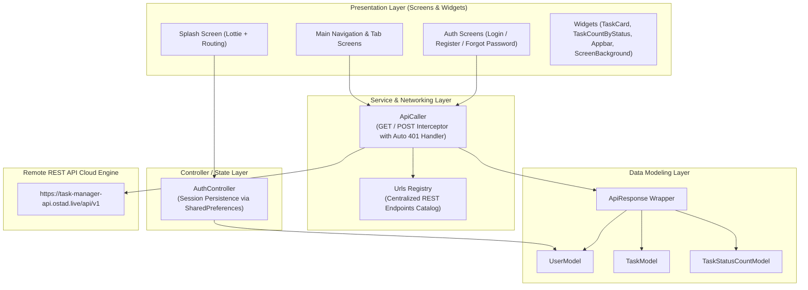
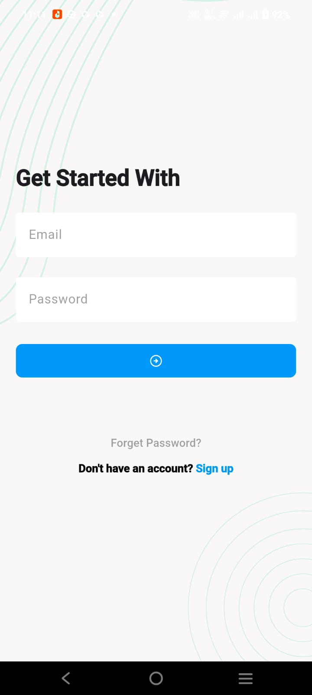
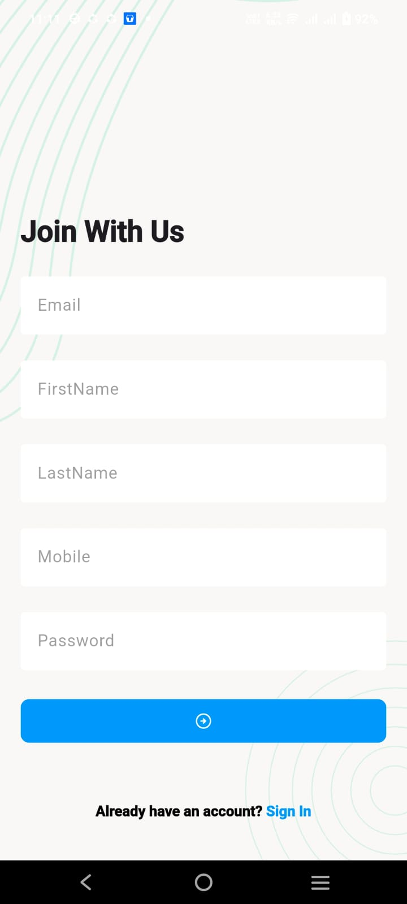
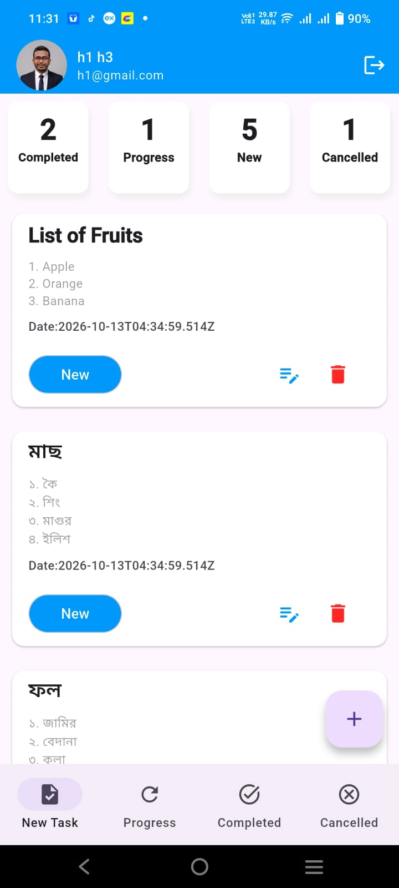
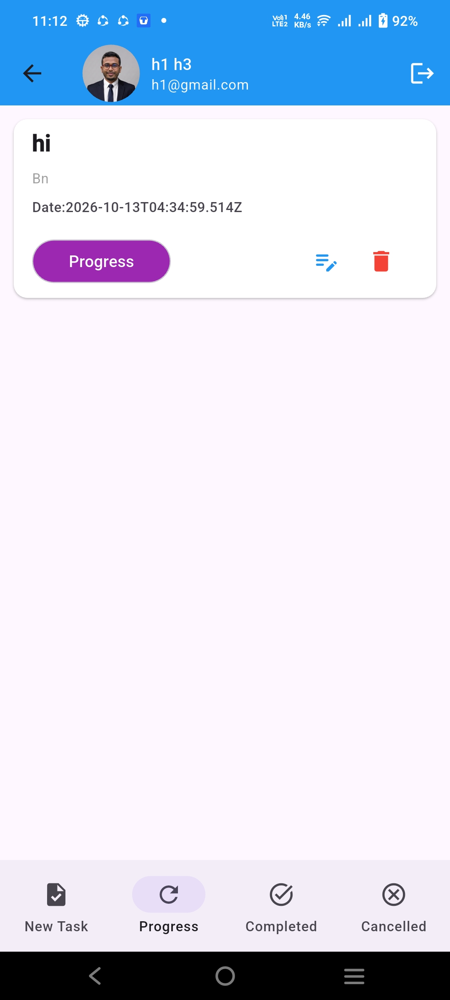
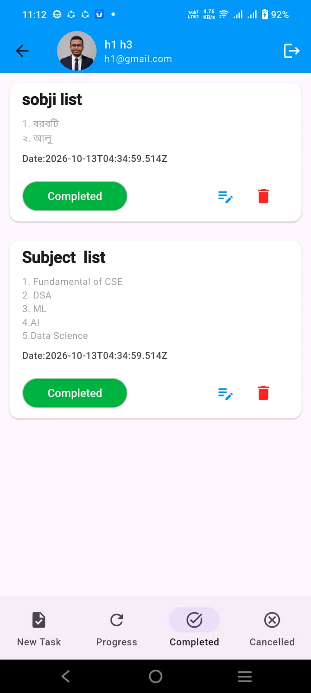
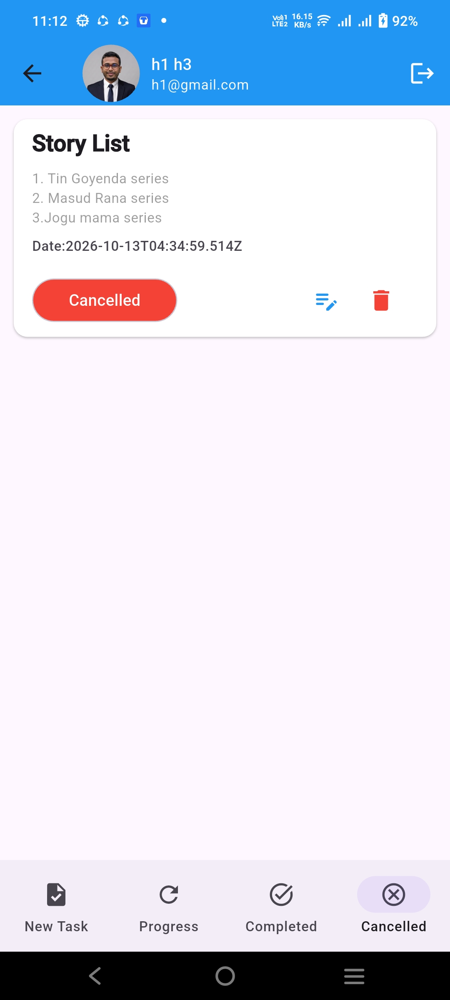
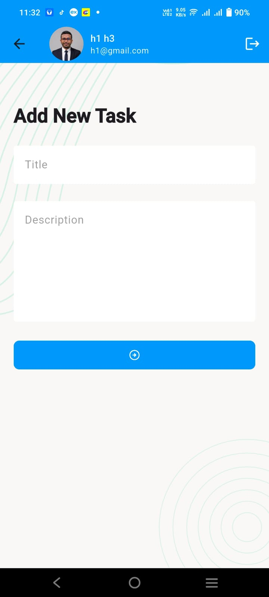
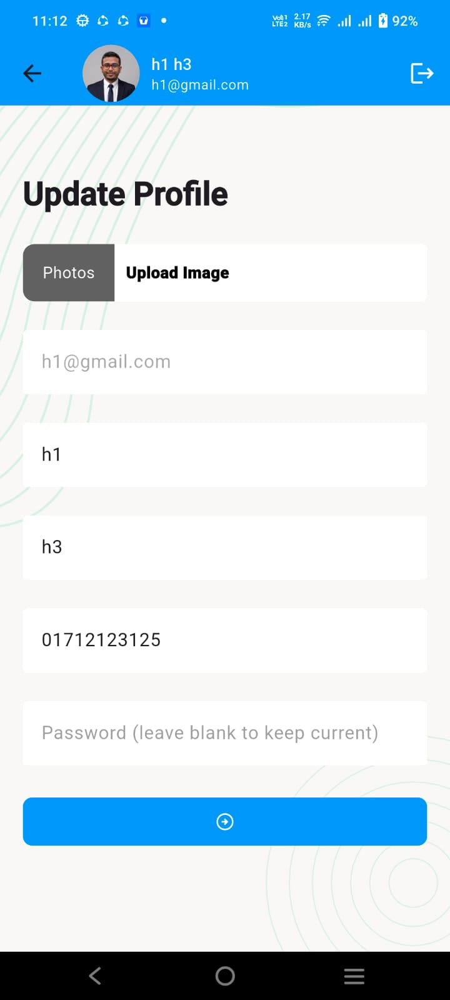

# 📝 Task Manager App

<p align="center">
  
</p>

<h2 align="center">Enterprise-Grade Task & Productivity Management Mobile Application</h2>

<p align="center">
  A robust, full-featured mobile productivity solution built with <strong>Flutter</strong> & <strong>Dart</strong>, powered by RESTful microservices, stateful lifecycle pipelines, and JWT session persistence.
</p>

<p align="center">
  <a href="https://flutter.dev"></a>
  <a href="https://dart.dev"></a>
  
  
  <a href="LICENSE"></a>
</p>

---

## 📑 Table of Contents

- [Executive Project Overview](#-executive-project-overview)
- [The Problem & The Solution](#-the-problem--the-solution)
- [Core Architectural Highlights & Innovations](#-core-architectural-highlights--innovations)
- [Visual UI Showcase (All 8 Screenshots)](#-visual-ui-showcase-all-8-screenshots)
- [Comprehensive Features Catalog](#-comprehensive-features-catalog)
- [Folder & File Architecture](#-folder--file-architecture)
- [Technology Stack, Packages & APIs](#-technology-stack-packages--apis)
  - [Flutter Packages Breakdown](#flutter-packages-breakdown)
  - [REST API Endpoints Specification](#rest-api-endpoints-specification)
- [Installation & Local Setup Guide](#-installation--local-setup-guide)
  - [Prerequisites](#prerequisites)
  - [Standard Setup](#standard-setup)
  - [FVM (Flutter Version Management)](#fvm-flutter-version-management)
- [Project Defense & Technical Q&A Cheat Sheet](#-project-defense--technical-qa-cheat-sheet)
- [Roadmap & Future Iterations](#-roadmap--future-iterations)
- [Contributing](#-contributing)
- [License & Authors](#-license--authors)

---

## 🌟 Executive Project Overview

**Task Manager App** is a cross-platform mobile productivity ecosystem designed to eliminate chaotic daily workflows, reduce cognitive overhead, and provide professionals and students with a unified dashboard for orchestrating everyday goals.

The application implements an end-to-end task lifecycle system categorized into four distinct pipelines: **New**, **In Progress**, **Completed**, and **Cancelled**. Each task moves across statuses with real-time UI counters, asynchronous REST backend synchronization, and persistent authentication state managed through local secure storage.

### Application Scope & Capabilities:
- **Autonomous Task Lifecycle Tracking**: Create, transition, monitor, and delete daily milestones in dedicated filtered streams.
- **Dynamic Analytic Metrics**: Horizontal status counter badges reflecting real-time task volume grouped by status.
- **Zero-Friction Authentication**: High-security user onboarding, JWT token-based authentication, and automated session recovery.
- **Three-Tier Password Recovery Engine**: Self-service recovery workflow integrating email OTP dispatch, 6-digit pin validation, and credential reset.
- **Adaptive Responsive Design**: Custom SVG vector rendering, Lottie vector animations, auto-fitting status cards, and strict null safety.

---

## 🎯 The Problem & The Solution

| The Traditional Challenge 🛑 | The Task Manager App Solution 🚀 |
|---|---|
| **Disorganized Task Tracking**: Tasks are scattered across paper notes, messaging apps, and memory, leading to missed deadlines. | **Categorized Kanban-Style Pipelines**: Tasks are strictly partitioned into `New`, `Progress`, `Completed`, and `Cancelled` views with one-tap status mutations. |
| **Silent Session Drops & Auth Crashes**: Network timeouts or expired JWTs cause silent app crashes or broken state. | **Global Interceptor & Auto-Logout**: Global navigation keys seamlessly intercept `401 Unauthorized` responses, purge expired tokens, and prompt clean re-authentication. |
| **Inaccurate Task Counters**: Users lack immediate high-level visibility over their productivity distribution. | **Live Aggregate Counters**: Horizontal auto-fitting metrics cards dynamically calculate sums for each status directly from server endpoints. |
| **Keyboard Overflows on Small Devices**: Multi-line description forms break UI layout boundaries when mobile keyboards deploy. | **Safe Scrollable Viewports**: All inputs reside inside non-overflowing `SingleChildScrollView` wrappers with reactive loading indicators. |
| **Forgotten Passwords Lock Users Out**: Lack of self-service recovery forces manual admin intervention. | **Automated 3-Step OTP Verification**: Integrated `RecoverVerifyEmail` $\rightarrow$ `RecoverVerifyOtp` $\rightarrow$ `RecoverResetPassword` flow. |

---

## 🏛️ Core Architectural Highlights & Innovations

The application adopts a **Layered Architecture (Decoupled MVC Pattern)** designed for testability, modularity, and high maintainability:



### Key Architectural Tenets:
1. **Centralized Network Interceptor (`ApiCaller`)**:
   - Encapsulates HTTP client operations (GET, POST).
   - Injects authentication bearer headers (`token: <jwt>`).
   - Automatically handles Nginx non-JSON HTML error pages without throwing unhandled `FormatException`.
   - Listens for `401 Unauthorized` or `{ status: "unauthorized" }` and triggers automated session clearance and redirect to login.
2. **Persistent Session Controller (`AuthController`)**:
   - Manages user credentials in memory (`static UserModel? userData`, `static String? accessToken`).
   - Synchronizes persistent user profile models and tokens with disk via `SharedPreferences`.
3. **Decoupled Design System**:
   - Custom `ScreenBackground` creates an SVG vector art backdrop while preserving `SafeArea` boundaries.
   - `TaskCountByStatus` utilizes `FittedBox(fit: BoxFit.scaleDown)` to dynamically scale text without layout overflows.
   - `TaskManagerAppBar` provides consistent profile identity (avatar, full name, email) and unified logout handling.

---

## 📱 Visual UI Showcase (All 8 Screenshots)

All screenshots are captured directly from real device executions and located in the [`Screenshots/`](Screenshots/) directory.

<p align="center">
  <table width="100%">
    <tr>
      <td align="center" width="50%">
        <strong>1. Sign In Screen</strong><br/>
        <em>Secure JWT Authentication & Session Entry</em><br/><br/>
        
      </td>
      <td align="center" width="50%">
        <strong>2. Sign Up Screen</strong><br/>
        <em>New User Registration with Client Validation</em><br/><br/>
        
      </td>
    </tr>
    <tr>
      <td align="center" width="50%">
        <strong>3. New Task Screen (Dashboard)</strong><br/>
        <em>Real-time Status Counters & New Task Stream</em><br/><br/>
        
      </td>
      <td align="center" width="50%">
        <strong>4. In Progress Screen</strong><br/>
        <em>Ongoing Task Pipeline with Status Badges</em><br/><br/>
        
      </td>
    </tr>
    <tr>
      <td align="center" width="50%">
        <strong>5. Completed Task Screen</strong><br/>
        <em>Successfully Finished Milestones Pipeline</em><br/><br/>
        
      </td>
      <td align="center" width="50%">
        <strong>6. Cancelled Task Screen</strong><br/>
        <em>Archived and Deprecated Tasks View</em><br/><br/>
        
      </td>
    </tr>
    <tr>
      <td align="center" width="50%">
        <strong>7. Add New Task Screen</strong><br/>
        <em>Form with Multi-line Description & Validation</em><br/><br/>
        
      </td>
      <td align="center" width="50%">
        <strong>8. Update Profile Screen</strong><br/>
        <em>User Profile Settings, Avatar & Credentials Update</em><br/><br/>
        
      </td>
    </tr>
  </table>
</p>

---

## ⚡ Comprehensive Features Catalog

### 1. 🔐 Authentication & Session Persistence
- **Client Form Validation**: Regex-based email verification, required field guards, and password length checks.
- **JWT Storage**: Tokens cached to `SharedPreferences` on login and restored automatically during application boot.
- **Self-Healing Session Expiration**: Automatic detection of expired/invalid tokens with immediate user redirection to login.
- **Functional Logout Action**: Clears cached user credentials and resets global controller state.

### 2. 🔑 3-Tier Password Recovery Engine
- **Email Verification (`ForgetPasswordEmailVerify`)**: Dispatches a 6-digit OTP verification pin to the registered email.
- **PIN Verification (`ForgetPasswordPinVerify`)**: Interactive 6-box input field powered by `pin_code_fields` with automatic submission upon typing the 6th digit.
- **Password Reset (`ForgetPasswordSetPassword`)**: Secure dual-field password entry ensuring confirmation matching before backend update.

### 3. 📋 Dynamic Task Lifecycle Pipelines
- **New Tasks**: Incoming tasks with real-time aggregate count metrics.
- **In Progress Tasks**: Active work items equipped with color-coded status chips (Purple).
- **Completed Tasks**: Finished milestones tagged with green status indicators.
- **Cancelled Tasks**: Discontinued items highlighted in red.
- **Task Status Mutation**: Interactive modal bottom-sheet/dialog allowing instant status updates (`New` $\rightarrow$ `Progress` $\rightarrow$ `Completed` $\rightarrow$ `Cancelled`).
- **Task Deletion**: One-tap delete with parent list auto-refresh.

### 4. 📊 Dashboard Status Counter Cards
- Real-time aggregate count cards displayed in a horizontal carousel.
- Auto-fitted typography (`FittedBox`) to eliminate numerical or text overflow across diverse screen sizes.

---

## 📂 Folder & File Architecture

```
task_manager_app/
├── android/                                 # Native Android platform configurations
├── ios/                                     # Native iOS platform configurations
├── assets/                                  # Static media & vector assets
│   └── images/
│       ├── background.svg                   # Reusable vector backdrop art
│       ├── profilePic.png                   # Default fallback user profile avatar
│       └── splash.json                      # Vector Lottie animation for splash screen
├── Screenshots/                             # High-definition application screenshots
│   ├── sign_in.jpeg                         # Sign in / login view
│   ├── sign_up.jpeg                         # User registration view
│   ├── new_task_screen.jpeg                 # New task dashboard & status counter cards
│   ├── progress_screen.jpeg                 # Tasks in progress view
│   ├── complete_screen.jpeg                 # Completed tasks view
│   ├── cancel_screen.jpeg                   # Cancelled tasks view
│   ├── add_new_task_screen.jpeg             # Task creation form view
│   └── update_screen.jpeg                   # Profile update & settings view
├── UI Screenshot/                           # Legacy documentation captures
├── lib/                                     # Core application Dart source code
│   ├── controller/                          # Application state controllers
│   │   └── auth_controller.dart             # Session, token & SharedPreferences persistence
│   ├── data/                                # Data layer (Models & Services)
│   │   ├── model/                           # Data serialization entities
│   │   │   ├── api_response.dart            # Standardized API response wrapper entity
│   │   │   ├── task_model.dart              # Task item entity with fromJson/toJson
│   │   │   ├── task_status_count_model.dart # Aggregated task status counter entity
│   │   │   └── user_model.dart              # User profile entity with serialization
│   │   └── service/                         # External networking clients
│   │       └── api_caller.dart              # Central HTTP client (GET, POST, logging, 401 interceptor)
│   ├── screens/                             # UI Presentation views
│   │   ├── add_new_task_screen.dart         # Task creation form with validation
│   │   ├── cancel_task_screen.dart          # Cancelled task pipeline view
│   │   ├── completed_task_screen.dart       # Completed task pipeline view
│   │   ├── forget_password_email_verify.dart# Recovery Step 1: Email OTP request
│   │   ├── forget_password_pin_verify.dart  # Recovery Step 2: 6-digit OTP verification
│   │   ├── forget_password_set_password.dart# Recovery Step 3: Password reset submission
│   │   ├── login_screen.dart                # User login screen with JWT authentication
│   │   ├── main_nav_screen.dart             # Scaffold with Material 3 navigation bar
│   │   ├── new_task_screen.dart             # Main dashboard with task counter cards
│   │   ├── progress_task_screen.dart        # In-progress task pipeline view
│   │   ├── sign_up_screen.dart              # User registration screen
│   │   ├── splash_screen.dart               # Splash screen with Lottie animation & auth routing
│   │   └── update_profile_screen.dart       # User profile & account update screen
│   ├── utils/                               # Shared constants & helper definitions
│   │   ├── app_color.dart                   # Global theme palette constants
│   │   ├── asset_path.dart                  # Asset paths registry for SVGs & Lottie
│   │   └── urls.dart                        # Central REST API catalog and URL builders
│   ├── widgets/                             # Modular reusable UI components
│   │   ├── screen_background.dart           # SVG vector background wrapper
│   │   ├── task_card.dart                   # Reusable task card with edit & delete actions
│   │   ├── task_count_by_status.dart        # Auto-fitting counter badge card
│   │   └── task_manager_appbar.dart         # Profile identity app bar with logout action
│   ├── app.dart                             # MaterialApp setup, GlobalKey, & ThemeData
│   └── main.dart                            # Application entry point (`WidgetsFlutterBinding`)
├── test/                                    # Unit and widget test suite
├── .fvmrc                                   # Flutter Version Management specification (3.41.1)
├── analysis_options.yaml                    # Dart analyzer & linter configurations
├── pubspec.yaml                             # Dependencies, assets, and project manifest
└── README.md                                # Project documentation
```

---

## 🛠️ Technology Stack, Packages & APIs

### Flutter Packages Breakdown

| Package | Version | Architectural Responsibility |
|---|---|---|
| [`http`](https://pub.dev/packages/http) | `^1.6.0` | Executes asynchronous HTTP network requests (GET, POST) with headers, payloads, and status code verification. |
| [`shared_preferences`](https://pub.dev/packages/shared_preferences) | `^2.5.5` | Persists user session tokens and serialized user data across mobile application restarts. |
| [`flutter_svg`](https://pub.dev/packages/flutter_svg) | `latest` | High-fidelity vector graphics rendering for resolution-independent background designs. |
| [`lottie`](https://pub.dev/packages/lottie) | `latest` | Renders rich vector JSON animations on the Splash Screen with zero frame drops. |
| [`pin_code_fields`](https://pub.dev/packages/pin_code_fields) | `^8.0.1` | Customized 6-box input field for seamless OTP and pin code verification. |
| [`logger`](https://pub.dev/packages/logger) | `^2.7.0` | Structured debugging console output for URLs, request headers, status codes, and JSON bodies. |
| [`cupertino_icons`](https://pub.dev/packages/cupertino_icons) | `^1.0.8` | Standard iOS-style iconography assets. |
| [`flutter_lints`](https://pub.dev/packages/flutter_lints) | `^6.0.0` | Official Flutter static code analysis and quality guidelines. |

---

### REST API Endpoints Specification

Base URL: `https://task-manager-api.ostad.live/api/v1`

| Feature | Method | Endpoint | Headers / Auth | Payload / Parameters | Success Response |
|---|:---:|---|:---:|---|---|
| **Registration** | `POST` | `/Registration` | `Content-Type: application/json` | `{"email": "", "firstName": "", "lastName": "", "mobile": "", "password": ""}` | `{"status": "success", "data": {...}}` |
| **Login** | `POST` | `/Login` | `Content-Type: application/json` | `{"email": "", "password": ""}` | `{"status": "success", "token": "jwt...", "data": {...}}` |
| **Profile Update** | `POST` | `/ProfileUpdate` | `token: <jwt>` | `{"email": "", "firstName": "", "lastName": "", "mobile": "", "password": ""}` | `{"status": "success", "data": {...}}` |
| **Task Status Count** | `GET` | `/taskStatusCount` | `token: <jwt>` | None | `{"status": "success", "data": [{"_id": "New", "sum": 5}, ...]}` |
| **Create Task** | `POST` | `/createTask` | `token: <jwt>` | `{"title": "", "description": "", "status": "New"}` | `{"status": "success", "data": {...}}` |
| **Tasks By Status** | `GET` | `/listTaskByStatus/:status` | `token: <jwt>` | Path Param: `New`, `Progress`, `Completed`, `Cancelled` | `{"status": "success", "data": [{...}]}` |
| **Update Task Status** | `GET` | `/updateTaskStatus/:id/:status` | `token: <jwt>` | Path Params: Task ID, New Status | `{"status": "success", "data": {...}}` |
| **Delete Task** | `GET` | `/deleteTask/:id` | `token: <jwt>` | Path Param: Task ID | `{"status": "success", "data": {...}}` |
| **Recover Verify Email** | `GET` | `/RecoverVerifyEmail/:email` | None (Public) | Path Param: User Email | `{"status": "success", "data": "OTP Sent"}` |
| **Recover Verify OTP** | `GET` | `/RecoverVerifyOtp/:email/:otp`| None (Public) | Path Params: User Email, 6-digit OTP | `{"status": "success", "data": "OTP Verified"}` |
| **Recover Reset Password**| `POST` | `/RecoverResetPassword` | None (Public) | `{"email": "", "OTP": "", "password": ""}` | `{"status": "success", "data": "Password Reset"}` |

---

## 🚀 Installation & Local Setup Guide

### Prerequisites
Before running the project locally, verify that your development machine has:
- [Flutter SDK](https://docs.flutter.dev/get-started/install) (`>= 3.11.0` or `3.41.x`)
- [Dart SDK](https://dart.dev/get-dart) (`>= 3.x`)
- Android Studio / VS Code with Flutter and Dart extensions
- Android Emulator / iOS Simulator or connected physical testing device

### Standard Setup

1. **Clone the repository:**
   ```bash
   git clone https://github.com/biswasbn99/Task_Manager_App.git
   cd Task_Manager_App
   ```

2. **Install project dependencies:**
   ```bash
   flutter pub get
   ```

3. **Verify Flutter environment:**
   ```bash
   flutter doctor
   ```

4. **Run the application:**
   ```bash
   flutter run
   ```

### FVM (Flutter Version Management)
This project includes `.fvmrc` configured for Flutter version `3.41.1`. If you use [FVM](https://fvm.app/):

```bash
# Install and use pinned version
fvm install
fvm use

# Run commands via FVM
fvm flutter pub get
fvm flutter run
```

---

## 💡 Project Defense & Technical Q&A Cheat Sheet

Prepare for technical evaluations, portfolio reviews, and project defense with these key insights:

<details>
<summary><strong>Q1: How does the application handle session persistence and authentication state?</strong></summary>
<br/>
When a user logs in via <code>Urls.signInURL</code>, the API returns a JWT bearer token alongside the user profile JSON. <code>AuthController.saveUserData(model, token)</code> stores the token and serialized model in <code>SharedPreferences</code> and synchronizes memory static variables. Upon subsequent launches, <code>SplashScreen</code> invokes <code>AuthController.getUserData()</code> and <code>AuthController.isUserLoggIn()</code> to determine whether to route into <code>MainNavScreen</code> or <code>LoginScreen</code> without prompting credentials again.
</details>

<details>
<summary><strong>Q2: How does the app prevent silent failures when tokens expire (401 Unauthorized)?</strong></summary>
<br/>
In <code>ApiCaller</code>, every HTTP response is intercepted. If <code>response.statusCode == 401</code> or the response JSON indicates <code>{"status": "unauthorized"}</code>, <code>ApiCaller._handleUnauthorized()</code> triggers: it clears cached data via <code>AuthController.clearUserData()</code> and uses <code>TaskManagerApp.navigatorKey</code> to route the user back to <code>LoginScreen</code> with a friendly session expiration notification.
</details>

<details>
<summary><strong>Q3: Why was data not showing in CompletedTaskScreen and how was it fixed?</strong></summary>
<br/>
In the earlier implementation, <code>setState(() { allTask = task; })</code> was accidentally scoped inside the <code>else</code> block. When the network response succeeded, the items were added to the local list, but <code>setState()</code> was skipped entirely, keeping <code>allTask</code> empty in the UI. Moving <code>setState()</code> outside the conditional block and guarding it with <code>if (mounted)</code> immediately resolved the issue.
</details>

<details>
<summary><strong>Q4: How does TaskCountByStatus prevent text overflows on small screens?</strong></summary>
<br/>
Rather than relying on fixed text styling within constrained boxes, <code>TaskCountByStatus</code> wraps both the count and title inside <code>FittedBox(fit: BoxFit.scaleDown)</code> and utilizes normalized padding (<code>horizontal: 8.0</code>). If a status title (e.g., "Completed" or "Cancelled") exceeds the available space, it automatically scales down its font size instead of throwing an overflow exception.
</details>

<details>
<summary><strong>Q5: How does the 3-step Password Recovery pipeline work?</strong></summary>
<br/>
1. <strong>Step 1 (Email Verification)</strong>: <code>RecoverVerifyEmail</code> verifies account existence and triggers OTP dispatch.<br/>
2. <strong>Step 2 (PIN Verification)</strong>: <code>RecoverVerifyOtp</code> verifies the 6-digit code entered in <code>PinCodeTextField</code>.<br/>
3. <strong>Step 3 (Password Reset)</strong>: <code>RecoverResetPassword</code> sends a POST request with email, verified OTP, and the new password, returning the user to the login screen upon completion.
</details>

---

## 🗺️ Roadmap & Future Iterations

- [x] Full REST API integration for New, Progress, Completed, and Cancelled task lists.
- [x] Real-time aggregate count metrics cards with `FittedBox` auto-scaling.
- [x] Complete 3-step Password Recovery flow (Email $\rightarrow$ OTP $\rightarrow$ Reset).
- [x] Functional user logout with cache invalidation and global navigation routing.
- [ ] Profile photo upload integration using multipart form requests.
- [ ] Migration to reactive state management (GetX / BLoC) for consolidated reactive bindings.
- [ ] Offline caching and local SQLite / Hive persistence with background synchronization.

---

## 🤝 Contributing

Contributions are warmly welcomed! To contribute:

1. Fork the Project repository
2. Create your Feature Branch (`git checkout -b feature/AmazingFeature`)
3. Commit your changes (`git commit -m 'feat: Add AmazingFeature'`)
4. Push to the Branch (`git push origin feature/AmazingFeature`)
5. Open a Pull Request

---

## 📄 License & Authors

Distributed under the **MIT License**. See `LICENSE` for further details.

Developed with ❤️ by **[BN Biswas](https://github.com/biswasbn99)**.  
*Crafted using Flutter & Dart.*
