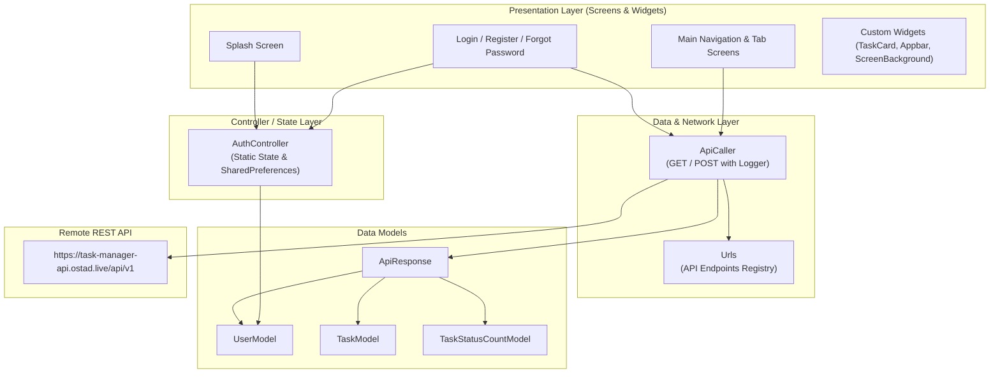

# 📝 Task Manager App

<p align="center">
  
</p>

<h3 align="center">A Modern, Clean, and Feature-Rich Task Management Mobile Application</h3>

<p align="center">
  Built with <strong>Flutter</strong> & <strong>Dart</strong> | RESTful API Integration | JWT Authentication
</p>

<p align="center">
  
  
  
  
  
</p>

---

## 📖 Table of Contents

- [Overview](#-overview)
- [UI Screenshots](#-ui-screenshots)
- [Key Features](#-key-features)
- [Technologies & Packages](#-technologies--packages)
- [Project Architecture](#-project-architecture)
- [Folder Structure](#-folder-structure)
- [API Endpoints Reference](#-api-endpoints-reference)
- [Getting Started & Installation](#-getting-started--installation)
  - [Prerequisites](#prerequisites)
  - [Setup Guide](#setup-guide)
  - [Using FVM (Flutter Version Management)](#using-fvm-flutter-version-management)
- [Roadmap & Upcoming Features](#-roadmap--upcoming-features)
- [Contributing](#-contributing)
- [Author & License](#-author--license)

---

## 🌟 Overview

**Task Manager App** is a full-featured mobile productivity application developed using the **Flutter** framework. Designed with an intuitive Material Design 3 interface, the application empowers users to effortlessly organize, monitor, and track their everyday tasks through diverse status pipelines: **New**, **In Progress**, **Completed**, and **Cancelled**.

The application communicates with a live REST backend API, handling secure token-based authentication (JWT), dynamic task creation, status count summaries, and persistent session storage.

### Core Highlights:
- 🔐 **Secure Authentication**: End-to-end user registration and login with JWT token persistence.
- 📊 **Status Summaries**: Real-time aggregation cards displaying task distributions across all categories.
- 📋 **Lifecycle Tracking**: Segregated views for New, In-Progress, Completed, and Cancelled tasks.
- 🎨 **Sleek Visual Experience**: Custom SVG background styling, Lottie vector animations, and Material 3 design elements.
- 📱 **Cross-Platform**: Production-ready code structured for both Android and iOS devices.

---

## 📱 UI Screenshots

<p align="center">
  <table>
    <tr>
      <td align="center" width="50%">
        <strong>🚀 Splash Screen</strong><br/><br/>
        
        <br/><em>Interactive Lottie animation with custom SVG background pattern</em>
      </td>
      <td align="center" width="50%">
        <strong>🏠 Home / Dashboard Screen</strong><br/><br/>
        
        <br/><em>Personalized user header, status counters, and navigation tabs</em>
      </td>
    </tr>
  </table>
</p>

---

## ⚡ Key Features

### 1. 🛡️ User Authentication & Profile
- **User Registration**: Create a new account with email, first name, last name, mobile number, and password.
- **Secure Sign In**: JWT Bearer token-based login flow.
- **Session Persistence**: Automatic login persistence using `shared_preferences` so users stay signed in across sessions.
- **Interactive Header**: Custom App Bar displaying user profile picture, full name, email, and logout action.
- **Profile Update Screen**: Dedicated UI layout ready for user details and avatar updates.

### 2. 🔑 Password Recovery Workflow
- **Email Verification**: Form to request a 6-digit recovery PIN.
- **PIN Verification**: Elegant 6-digit PIN input powered by `pin_code_fields`.
- **Set Password**: Reset and confirm new password with minimum security constraints.

### 3. 📋 Task Management & Lifecycle
- **Task Creation**: Add new tasks with title, multi-line description, and default initial status.
- **Status Categorization**:
  - 🔵 **New Tasks**: Newly created tasks awaiting commencement.
  - 🟣 **In Progress**: Tasks actively being worked on.
  - 🟢 **Completed**: Successfully finished tasks.
  - 🔴 **Cancelled**: Deprecated or cancelled tasks.
- **Task Summary Badges**: Top horizontal overview cards reflecting dynamic counts fetched from `/taskStatusCount`.
- **Status Chips & Cards**: Styled task cards displaying task details, creation date, status chip, and quick-action buttons (edit and delete).

### 4. 🎨 Design & Visual Architecture
- **Reusable Background**: Custom `ScreenBackground` widget incorporating responsive vector graphics (`background.svg`).
- **Animated Splash Screen**: Built with `lottie` vector animations and intelligent auto-routing based on auth status.
- **Material 3 Navigation Bar**: Smooth bottom navigation bar switching between task status tabs.

---

## 🛠️ Technologies & Packages

### Core Stack
| Technology | Description |
|---|---|
| **Flutter SDK** (`^3.11.0`) | Cross-platform UI toolkit by Google |
| **Dart SDK** | Client-optimized, object-oriented programming language |
| **FVM** (`3.41.1`) | Flutter Version Management for reproducible environment setups |

### Dependencies (`pubspec.yaml`)
| Package | Version | Purpose |
|---|---|---|
| [`http`](https://pub.dev/packages/http) | `^1.6.0` | Making HTTP REST API requests (GET, POST) with headers and JSON serialization |
| [`shared_preferences`](https://pub.dev/packages/shared_preferences) | `^2.5.5` | Key-value local storage for caching JWT auth tokens and user profile JSON data |
| [`flutter_svg`](https://pub.dev/packages/flutter_svg) | `latest` | High-performance SVG rendering for layered background art (`background.svg`) |
| [`lottie`](https://pub.dev/packages/lottie) | `latest` | Rendering fluid JSON-based animations on the Splash Screen (`splash.json`) |
| [`pin_code_fields`](https://pub.dev/packages/pin_code_fields) | `^8.0.1` | Customized boxed PIN / OTP input fields for password reset verification |
| [`logger`](https://pub.dev/packages/logger) | `^2.7.0` | Pretty console logging for network URLs, status codes, responses, and errors |
| [`path`](https://pub.dev/packages/path) | `^1.9.1` | Cross-platform file path manipulation and directory utilities |
| [`cupertino_icons`](https://pub.dev/packages/cupertino_icons) | `^1.0.8` | Default iOS icon asset library |

### Development Dependencies
| Package | Version | Purpose |
|---|---|---|
| [`flutter_lints`](https://pub.dev/packages/flutter_lints) | `^6.0.0` | Recommended code analysis rules and style guidelines |
| [`flutter_test`](https://api.flutter.dev/flutter/flutter_test/flutter_test-library.html) | `SDK` | Unit and widget testing framework |

---

## 🏗️ Project Architecture

The project adheres to a clean, decoupled **Layered / MVC-inspired** architecture pattern to ensure readability, scalability, and code reusability:



### Architectural Breakdown:
1. **Presentation Layer (`lib/screens/`, `lib/widgets/`)**:
   - Manages UI widgets, user inputs, form validations, animations, and tab transitions.
2. **Controller Layer (`lib/controller/`)**:
   - `AuthController`: Centralizes session lifecycle, auth token storage, user deserialization, and login status verification using `SharedPreferences`.
3. **Service Layer (`lib/data/service/`)**:
   - `ApiCaller`: Encapsulates `http.Client`, injects the JWT authentication header (`token: <accessToken>`), executes JSON encode/decode, and logs request payloads and responses using `Logger`.
4. **Data Models (`lib/data/model/`)**:
   - Strongly-typed parsing models with `fromJson` and `toJson` methods for safe serialization.
5. **Utils (`lib/utils/`)**:
   - Central location for static endpoints (`Urls`), color palette (`AppColor`), and asset path constants (`AssetPaths`).

---

## 📂 Folder Structure

```
task_manager_app/
├── android/                        # Native Android configuration & build scripts
├── ios/                            # Native iOS configuration & Xcode project
├── assets/                         # Static application assets
│   └── images/
│       ├── background.svg          # Background vector illustration for screens
│       ├── profilePic.png          # Fallback user profile avatar
│       └── splash.json             # Lottie animation file for splash screen
├── UI Screenshot/                  # Application UI captures for documentation
│   ├── home_screen.jpeg            # Home screen & bottom bar preview
│   └── splash_screen.jpeg          # Splash screen & Lottie preview
├── lib/                            # Dart source code
│   ├── controller/                 # State & session controllers
│   │   └── auth_controller.dart    # Manages user token & SharedPreferences session
│   ├── data/
│   │   ├── model/                  # Data entity models (JSON serialization)
│   │   │   ├── api_response.dart   # Generic API response wrapper
│   │   │   ├── task_model.dart     # Task data entity
│   │   │   ├── task_status_count_model.dart # Aggregated task count model
│   │   │   └── user_model.dart     # User profile entity
│   │   └── service/                # Networking & API integrations
│   │       └── api_caller.dart     # HTTP client service (GET, POST with token header)
│   ├── screens/                    # Application UI views
│   │   ├── add_new_task_screen.dart          # Create new task form
│   │   ├── cancel_task_screen.dart           # Cancelled tasks tab view
│   │   ├── completed_task_screen.dart        # Completed tasks tab view
│   │   ├── forget_password_email_verify.dart # Email verification screen
│   │   ├── forget_password_pin_verify.dart   # 6-digit PIN verification screen
│   │   ├── forget_password_set_password.dart # Reset new password screen
│   │   ├── login_screen.dart                 # User login screen
│   │   ├── main_nav_screen.dart              # Bottom navigation bar container
│   │   ├── new_task_screen.dart              # New tasks dashboard with count cards
│   │   ├── progress_task_screen.dart         # Tasks in progress tab view
│   │   ├── sign_up_screen.dart               # User registration screen
│   │   ├── splash_screen.dart                # Splash screen with Lottie animation
│   │   └── update_profile_screen.dart        # Profile editing screen
│   ├── utils/                      # Helper constants & themes
│   │   ├── app_color.dart          # Global color theme constants
│   │   ├── asset_path.dart         # Image and Lottie asset path definitions
│   │   └── urls.dart               # REST API base URL and endpoint catalog
│   ├── widgets/                    # Reusable modular UI components
│   │   ├── screen_background.dart  # SVG background wrapper with SafeArea
│   │   ├── task_card.dart          # Reusable card component for task items
│   │   ├── task_count_by_status.dart # Mini summary counter card widget
│   │   └── task_manager_appbar.dart# Profile App Bar with user info & logout
│   ├── app.dart                    # MaterialApp definition & global theme configuration
│   └── main.dart                   # Application entry point (`runApp`)
├── test/                           # Unit and widget tests
├── .fvmrc                          # Flutter Version Management specification
├── analysis_options.yaml           # Dart analyzer and linting rules
├── pubspec.yaml                    # Package dependencies and asset configurations
└── README.md                       # Project documentation
```

---

## 🌐 API Endpoints Reference

All network requests interact with the base API:
`https://task-manager-api.ostad.live/api/v1`

| Action | Method | Endpoint | Auth Required | Description |
|---|---|---|---|---|
| **Registration** | `POST` | `/Registration` | ❌ No | Registers a new user account with profile credentials |
| **Login** | `POST` | `/Login` | ❌ No | Authenticates user credentials and returns JWT bearer token |
| **Task Counts** | `GET` | `/taskStatusCount` | ✅ Yes (`token`) | Fetches total count of tasks grouped by status |
| **Create Task** | `POST` | `/createTask` | ✅ Yes (`token`) | Creates a new task with title, description, and status |
| **Task by Status** | `GET` | `/listTaskByStatus/:status` | ✅ Yes (`token`) | Lists all tasks filtered by status (`New`, `Progress`, `Completed`, `Cancel`) |

> **Note:** Authenticated requests automatically attach the stored token header:  
> `headers: {'token': AuthController.accessToken}`

---

## 🚀 Getting Started & Installation

### Prerequisites
Before running the project, ensure you have installed:
- [Flutter SDK](https://docs.flutter.dev/get-started/install) (`>= 3.11.0` or `3.41.x`)
- [Dart SDK](https://dart.dev/get-dart)
- Android Studio / Xcode (with emulator or physical device configured)
- Git command line tools

### Setup Guide

1. **Clone the repository:**
   ```bash
   git clone https://github.com/biswasbn99/Task_Manager_App.git
   cd Task_Manager_App
   ```

2. **Install project dependencies:**
   ```bash
   flutter pub get
   ```

3. **Verify Flutter environment:**
   ```bash
   flutter doctor
   ```

4. **Run the application:**
   ```bash
   flutter run
   ```

### Using FVM (Flutter Version Management)
This project includes `.fvmrc` configured for Flutter version `3.41.1`. If you use [FVM](https://fvm.app/):

```bash
# Install configured version
fvm install

# Use configured version
fvm use

# Run flutter commands via FVM
fvm flutter pub get
fvm flutter run
```

---

## 🗺️ Roadmap & Upcoming Features

- [ ] **Task Status Mutation**: Enable users to change status between New, Progress, Completed, and Cancelled via a modal bottom sheet.
- [ ] **Delete & Edit Tasks**: Connect the delete button and edit action to live REST API endpoints.
- [ ] **Profile Picture Upload**: Implement image picker and multipart upload for custom user avatars.
- [ ] **Complete Password Reset**: Wire up the OTP verification and reset password screens to the backend API.
- [ ] **State Management Upgrade**: Transition controllers to Provider / GetX / Bloc for streamlined reactive state updates.
- [ ] **Pull-to-Refresh & Shimmer Effects**: Add animated loading placeholders and pull-to-refresh capabilities.

---

## 🤝 Contributing

Contributions, issues, and feature requests are welcome!  
Feel free to check the [issues page](https://github.com/biswasbn99/Task_Manager_App/issues) if you want to contribute:

1. Fork the Project
2. Create your Feature Branch (`git checkout -b feature/AmazingFeature`)
3. Commit your Changes (`git commit -m 'Add some AmazingFeature'`)
4. Push to the Branch (`git push origin feature/AmazingFeature`)
5. Open a Pull Request

---

## 📄 License & Author

Distributed under the **MIT License**. See `LICENSE` for more information.

Developed by **[BN Biswas](https://github.com/biswasbn99)**.  
*Crafted with ❤️ using Flutter.*

